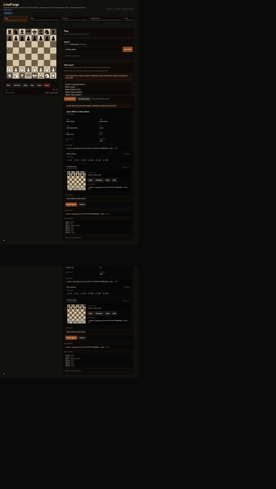

# LineForge

A local-first chess memory system for turning games into reviewable decisions.

**Product thesis:** Lichess is where you play. LineForge is where your chess memory compounds.

LineForge is a private post-game study app. It helps you import games, inspect the moves before replacing your board, annotate what you thought, create mistake cards from your own positions, review those cards by playing the move, schedule due reviews from local history, map recurring opening weaknesses, and export compact learning artifacts.

## First run

Requires Git, **Node.js 22.18 or newer**, npm, and a modern browser. The version
below is a local v0.1 prototype; the study loop does not require an account,
external AI service, or Stockfish analysis.

```bash
git clone https://github.com/zacharymplace/lineforge.git
cd lineforge
npm ci
npm run dev
```

Open the local URL printed by Next.js (normally `http://localhost:3000`). Keep
the terminal open and press Ctrl+C to stop. The development command uses POSIX
environment-variable syntax; on Windows use WSL or run `npx next dev` from
PowerShell without the optional polling flag.

Start with **Play → Try demo game → Import game**, then save the draft. Annotate
a move in Study, create a mistake card, and inspect it in Review. The full demo
steps are below. Browser `localStorage` holds study data: export a JSON backup
before clearing site data or switching browser/origin.

## Example screen and prototype limits



This checked-in development capture comes from the
[September 7 demo review](docs/demo-review-2026-09-07.md); current UI details may
have changed. It demonstrates the preview workflow, not real-player learning
gains. Game-recall cards rehearse the recorded move; a saved legal correction
is not automatically the best move. Coach lenses and summaries are deterministic,
and optional engine analysis is separate from the core loop. There are no
accounts, cloud sync, or multiplayer. Broader usability and accessibility
validation remain ongoing work.

## Core Loop

1. Import a PGN.
2. Preview metadata and scrub the game on a small board.
3. Save the game to the local library.
4. Annotate a move with your thought, verdict, and tags.
5. Create a mistake card from the position.
6. Review the card by playing the remembered move.
7. Attach optional local Stockfish analysis to selected positions.
8. Generate deterministic review summaries.
9. Compare deterministic coach lenses.
10. Drill individual cards or run filtered review sessions.
11. Repeat missed cards and inspect session history.
12. Follow deterministic due-review scheduling.
13. Filter DrillQueue by due status, source game, and last-reviewed recency.
14. Map, filter, and trend opening weaknesses.
15. Export review packets as Markdown or JSON.
16. Back up local data as JSON.

## Try The Demo Game

LineForge includes a small local demo PGN so a first-time evaluator does not need to bring their own game.

1. Run the app with `npm run dev`.
2. Open the Play workflow.
3. In PGN import, click **Try demo game**.
4. Inspect the preview metadata, move snippets, and preview board scrubber.
5. Click **Import game** to create an unsaved draft.

The demo uses the same safe PGN preview flow as pasted games. It does not replace the active board until import is confirmed.

Suggested first review flow:

1. Try demo game.
2. Confirm import.
3. Annotate a move with a thought, verdict, and tags.
4. Create a mistake card from that position.
5. Analyze the selected position with optional local Stockfish.
6. Review the card by playing the remembered move.
7. Export a review packet as Markdown or JSON.

## Features

### Local-First Saved Game Library

Save multiple games locally with names, PGNs, move lists, timestamps, and annotations. Draft, saved, and unsaved states are visible, with reload/discard and rename flows for saved games.

### PGN Import Preview

Paste a PGN or use the local demo game, inspect detected metadata, preview first/last moves, and scrub through the imported game on a smaller board before confirming. Invalid PGNs do not replace the active board.

### Move Annotations

Each ply can store:

- what you thought was happening
- verdict: good, mistake, blunder, unclear
- tags such as missed tactic, hung piece, king safety, bad trade, opening confusion, time pressure, and plan mismatch
- optional saved local engine analysis

### Mistake Cards

Create drill cards from your own positions. Cards preserve source game id, ply, FEN before/after, move SAN, prompt, note, tags, verdict, creation time, review stats, attempt history, and optional analysis.

### Drill Review

Select a card, see the position before the move, and try to play the answer on the board. Correct attempts are marked remembered; incorrect attempts are marked missed and reveal the expected move.

### Attempt History

Each drill attempt records when it happened, the attempted move/FEN when available, expected move, result, and whether it was played or manually revealed. Summary stats stay derived from that history.

### Review Sessions

Run focused sessions from filtered mistake-card queues. Sessions support filters, a persisted size selector, remembered/missed/skipped results, missed-only repeat sessions, completed summaries, and a history detail view with per-card results.

### Review Scheduling

LineForge builds a lightweight deterministic due-review schedule from local card data: attempts, correct counts, last reviewed dates, recent attempt history, verdicts, tags, opening weakness buckets, and skipped session results. Cards can be marked as due now, due soon, new, or stable.

Priority scoring is local and conservative. Missed last attempts, low success rates, important tags such as missed tactic or king safety, blunder verdicts, never-reviewed cards, and recent skipped results can raise a card's priority. The schedule panel can start a due-review session from due-now cards first, falling back to due-soon or new cards.

The schedule cadence can be adjusted with local deterministic presets:

- Gentle: less aggressive, with fewer urgent cards and a longer stable window.
- Standard: the default behavior and the original LineForge scheduling cadence.
- Intense: more aggressive, making skipped, stale, and lower-success cards surface sooner.

The selected preset persists in browser `localStorage`, invalid saved values normalize safely back to defaults, and Reset cadence restores Standard. LineForge does not include calendar integration, notifications, external scheduling services, or custom numeric scheduling controls.

### Schedule Badges

Mistake-card surfaces show compact text-based schedule badges. Badges expose the card's review status, priority context, success rate, last reviewed date, and a short recommended action such as "Review after missed attempt" or "Start first review." They are generated from local schedule helpers and do not depend on cloud services.

### DrillQueue Filtering

The DrillQueue card list can combine three lightweight local filters:

- Due status: all cards, due now, due soon, new, stable, and high priority.
- Source game: all games, current active saved game, or saved games that have cards.
- Last reviewed: all cards, never reviewed, reviewed today, reviewed in the last 7 days, or not reviewed in 7+ days.

Filtering only changes the visible list. It does not mutate cards or review history. If the selected card is hidden by a filter, DrillQueue selects the first visible card when available; if no cards match, it shows a clear empty state with the active filters.

Non-default filters appear as compact chips. Each chip can clear one filter, while Reset filters clears due status, source game, and last-reviewed filters together. The preferred due-status filter persists locally and shows a subtle "Filter saved locally" confirmation after changes. Source-game and last-reviewed filters are intentionally session-local.

### Optional Local Stockfish Analysis

Engine analysis is user-triggered, one position at a time, and runs locally in the browser through Stockfish. It can be attached to a move annotation or mistake card, but it is not required for the core study loop.

### Deterministic Review Summaries

LineForge turns saved notes, tags, verdicts, review history, and engine fields into factual summaries. These summaries are template-driven and conservative; they do not pretend to know more than the saved data supports.

### Coach Lenses

Coach lenses reframe the same move or card through deterministic perspectives:

- Blunder Audit
- Tactics
- King Safety
- Trade Check
- Opening Minimalist
- Plan Mismatch

### Lens Comparison

Compare up to three coach lenses side by side for the same position. The default comparison is Blunder Audit, Tactics, and Plan Mismatch, and the preferred comparison persists locally.

### Opening Weakness Map

LineForge builds a deterministic opening weakness map from local early-game cards where `ply <= 20`. Buckets include opening confusion, plan mismatch, missed tactic, bad trade, king safety, blunder, and unclear.

The map can be filtered by missed only, remembered only, current active saved game only, selected verdict, and selected tag. Filters can be reset, preferences persist locally, show a subtle "Filters saved locally" confirmation, and review sessions can start from a selected bucket or all visible filtered cards.

LineForge does not infer named openings; the map reflects only saved local cards, tags, verdicts, review stats, and optional engine fields.

### Opening Weakness Trends

Opening weakness trends group local opening-card review history by date and bucket. They summarize recent success rates, most missed buckets, improving/worsening buckets, and recommended next focus. Trend focus buckets can start review sessions.

### Review Packet Export

Export a selected move or drill card as a compact review packet. The preview modal shows Markdown and collapsible JSON before download. Packets can include review summaries, selected coach lens output, compared lens outputs, analysis, tags, notes, and review history.

### JSON Backup/Export

Export all local LineForge data as JSON and import it later. Backup validation checks the top-level shape, saved games, cards, attempts, FEN strings, and PGN legality where practical.

## What LineForge Is Not

LineForge is not:

- a Chess.com clone
- a Lichess replacement
- a multiplayer server
- an AI coach wrapper
- a cloud-first training product

LineForge is:

- a private chess notebook
- a mistake memory system
- a review queue built from your own games
- a deterministic coach lens system
- a portable learning artifact generator

## Architecture

LineForge uses small internal domains:

- **MoveLedger**: game state, PGN import, saved game library, annotations, localStorage, and backup data.
- **MistakeGraph**: mistake cards, aggregate mistake statistics, and opening weakness maps.
- **DrillQueue**: active card review, move-answer evaluation, attempt history, configurable local scheduling presets, schedule badges, combined DrillQueue filtering, active filter chips, selected-card fallback, review sessions, session history, and session/filter preferences.
- **Engine**: optional local Stockfish adapter, engine result formatting, depth preferences, and analysis attachment helpers.
- **Explanations**: deterministic review summaries and drill recommendations.
- **CoachLenses**: deterministic learning perspectives, lens comparison, and comparison preferences.
- **ReviewPackets**: compact JSON/Markdown packet construction, preview, filenames, and local download.
- **Preferences/localStorage helpers**: browser-local preferences for engine depth, coach lens comparison, review-session size, review schedule preset, opening weakness filters, and DrillQueue due-status filter. Source-game and last-reviewed DrillQueue filters stay session-local by design.
- **UI helpers**: small shared UI utilities such as `ScheduleBadge` and accessible `StatusHint` for polite saved/status messages.

More detail lives in [`docs/architecture.md`](docs/architecture.md).

## Portfolio Presentation Notes

Recommended screenshots for a portfolio page or case study:

- Play / PGN import: workflow navigation, main board, demo PGN preview, and preview scrubber.
- Study / annotation + engine: move annotation, saved analysis timestamp, deterministic summary, and coach lens output.
- Review / DrillQueue + schedule: schedule badges, active filter chips, DrillQueue card detail, and due-review controls.
- Weaknesses / opening map + trends: opening weakness buckets, filters, trend rows, and recommended focus.
- Data / backup + review packets: review packet preview modal, Markdown/JSON export, and local backup controls.

Development screenshots are checked into [`docs/screenshots/`](docs/screenshots/). See [`docs/case-study.md`](docs/case-study.md) for a portfolio-ready narrative and [`docs/demo-walkthrough.md`](docs/demo-walkthrough.md) for the manual sample-data walkthrough.

## Local Development

Install dependencies:

```bash
npm install
```

Run the app locally:

```bash
npm run dev
```

Run validation:

```bash
npm run test:lineforge-smoke
npm run lint
npm run build
```

## Privacy And Local-First Boundaries

- Core study data is stored in browser `localStorage`.
- Browser-local preferences store engine depth, coach lens comparison, review-session size, review schedule preset, opening weakness map filters, and DrillQueue due-status filter.
- DrillQueue source-game and last-reviewed filters are session-local and are not written to persistent storage.
- Backup/export uses local JSON files.
- Review packets download as local Markdown or JSON.
- Engine analysis uses local browser Stockfish and is optional.
- This version has no accounts, no cloud sync, no multiplayer, no payments, no external AI calls, and no LLM-generated explanations.

## Third-Party And Licensing Notes

LineForge uses:

- `chess.js` for chess rules, legal moves, FEN, and PGN handling.
- `react-chessboard` for board rendering and interaction.
- `stockfish` for optional local browser engine analysis.

See [`THIRD_PARTY_NOTICES.md`](THIRD_PARTY_NOTICES.md) for the Stockfish package/license note.

## Roadmap

Disciplined next steps:

- Refresh the development screenshots into a consistent current portfolio set.
- Add a sample-data walkthrough built around the demo game.
- Integrate the case study into a portfolio page.
- Consider an optional deployed static demo only after licensing and deployment constraints are handled.
- Review other transient error/status messages for polite status semantics.
- Add a stronger focus trap/dialog primitive if more modals are added.
- Add a local review calendar layer without external calendar integration first.
- Add optional custom numeric scheduling controls.
- Refine opening weakness trends over time.
- Run a broader accessibility review for complex flows.
- Add an optional AI coach layer only after deterministic review logic remains stable.

See [`docs/roadmap.md`](docs/roadmap.md) for more detail.
See [`docs/case-study.md`](docs/case-study.md) for a portfolio-style product narrative.

## Preview a backup replacement

In Data → Backup and JSON export tools, choosing a backup validates it and
shows the incoming saved-game, mistake-card, and completed-session counts. Your current data stays
unchanged until **Apply replacement**. This replaces the library, cards and active
game (including an unsaved draft); it does not merge records. **Cancel** discards
the preview. You can export your current data before applying the replacement.
Invalid or unreadable files leave current data unchanged and clear any older
preview. Selecting another file or cancelling while it is being read prevents
an older read from restoring a stale preview. Backup format remains v1 with an optional `sessionSummaries` field. New exports
include the completed history (up to the existing 20-session retention limit),
including per-card results, attempted/expected moves, filters and summary counts.
Apply validates the selected JSON again. Included history replaces current history;
an explicit empty array clears it. Older v1 backups without this field preserve
existing session history, as stated in the preview. Cancel changes nothing.
Active sessions and preferences are not included. Malformed history rejects the
entire import before replacement.

### Local study-data save status

The header separately reports whether the current game, library, mistake cards and completed session history
were saved in this browser. A restored backup is first applied to the current tab;
check this status before closing it. If browser storage is full or unavailable,
data remains in memory: keep the tab open, export a backup from Data, and use
**Retry local save** after resolving the storage problem. Later study-data changes
also retry saving. A successful retry clears the failure status.

These four storage keys are written separately, not atomically. A failed
save can leave mixed or older records on disk; the warning does not claim rollback.
This status covers study data, not every preference or active drill-session setting.
Backup v1 and Apply/Cancel replacement behavior are unchanged.

Focused checks: `npm run test:storage` and `npm run test:backup-history`.
